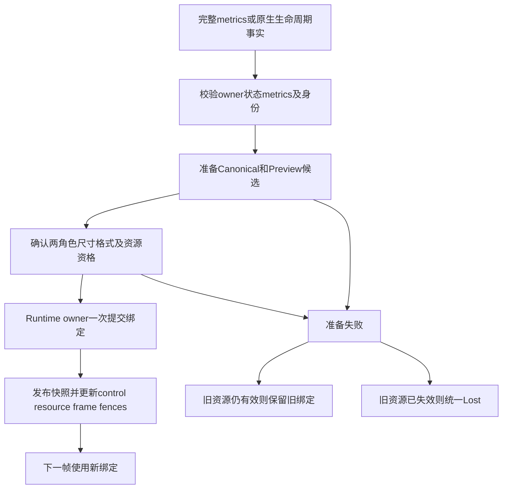

# Axiom Runtime 接口收敛与 Surface 生命周期修复分析

当前公共编辑入口已基本收拢，主要未闭合点是 surface 生命周期的提交边界。完整 SurfaceMetrics 只是修复所需载荷之一；同时需要处理两个 surface 角色、provider 准备失败、控制目标发布和旧工作失效，才能避免继续出现局部补丁。

源码基准为 `ae1a2e79b1f4e2eb36f81655f6819cc4a8a8173a`，仓库 Mostorm-Labs/axiom，分支 codex/fc00x-scene-resource-composition-p32-f08-resume。此分析只读生产源码，临时探针链接独立 v5 构建的精确库，没有修改生产代码或正式测试。

# 单实例使用与实例身份

Windows Minimal 当前只创建一个 MinimalRuntimeHost，它拥有一个 RuntimeComposition。因此日常运行是一个窗口持有一个 Runtime。源码中的 RuntimeComposition 构造函数是 public，没有进程级唯一实例限制；Web create 也按 handle 创建实例。这与全局 getInstance 式单例不同。

既有 FC-00X implementation-context 的表述是“one Runtime instance owns one Document/View binding”，不是“整个进程只能存在一个 Runtime”。同一 Document/Selection/History 不能有重复 owner，也不等于不能在别处创建另一个独立实例。

v5 的两个 Runtime 交换 token 探针证明了跨实例隔离没有实现；它没有证明普通单窗口 Minimal 已经发生串回执。因此应分开记录：

- 单实例旧 A 回执误确认新 B 已通过独立复验，是主链正确性结论。
- 跨实例 token 碰撞是公开 API 的隔离缺口；在明确单实例且不串生命周期回调的 Minimal 使用条件下，不应把它描述为已发生的用户问题。
- 实例重建后的旧回调仍值得做低成本防护，不需要实现多窗口、多文档或全局 Runtime 管理框架。

最小修复可以给 Runtime 构造时分配一个非 canonical 的运行期实例身份，并让不透明工作 token 在内部关联实例身份、绑定寿命、view、submission 和 surface/metrics/content 身份。平台原样回传 token，Runtime 验证其归属和当前资格。生命周期更新失效旧 token，close 后拒绝写入。

公共 token 不必暴露每个字段，也不要求新增一个全局 Registry。不要为此改变 canonical CommitStamp/RuntimeEpoch 的权威含义；当前内部 CanonicalCommitClock 初值可为1，不能未经证明把该值当作全进程唯一实例身份。

# 源码接入检查与物理验证的区别

| 问题 | 源码或自动化能确认什么 | 真机需要确认什么 |
| --- | --- | --- |
| Web 产品控制 | 当前页面和 WASM exports 没有工具/创建预设/Undo 等产品控制入口，普通页面无法通过现有桥调用它们 | 接通后检查鼠标/触摸操作、UI反馈、WebGL画面与实际时序 |
| Windows 原生输入 | 当前 Minimal 使用 WM_LBUTTON/WM_MOUSEMOVE，样本固定 source/pointer1、pressure0.5，未接入已有 WM_POINTER/history 适配 | 真实笔压、触摸身份、历史点、capture/cancel、多指导航及系统兼容性 |
| Runtime 输入编排 | 公共 PlatformPointerBatch → Runtime 工具/Session/Operation 可用自动化验证 | 原生采集事实是否正确、窗口事件是否丢失，需要设备观察 |
| 呈现 | 可以检查工作关联、dirty/qualified状态、实际 provider 像素与失败重试 | D3D12/WebGL可见画面、最大化恢复、设备/context丢失、闪烁与时延 |

“未接线”和“待真机验证”是两种状态。不能要求靠真机证明一个不存在的桥接函数，也不能用源码中的函数存在代替物理效果通过。普通笔设备可能被系统转换成鼠标事件，但这不证明笔压、双指身份或history路径已经支持。

本轮不据此宣称笔/触摸功能已在真机失败；它们分别是适配缺口与待观察项目。若产品暂时只要求鼠标 smoke，应在验收范围明确该限制，不能把鼠标 smoke 写成完整输入等价性。

# 当前接口收敛程度

| 边界 | 当前判断 |
| --- | --- |
| 产品意图 | RuntimeFacade 汇入同一 CanvasControlService，没有发现新 Minimal/Debug UI 中的第二套编辑 owner |
| 输入之后的逻辑 | 工具分发、Session、提交、History/Scene 由内部 Runtime 负责，普通平台没有必要调用内部 editor |
| 低层 preview 接缝 | Composition 的 capture/render/ack 已移为 private，公共调用链封口取得实质进展 |
| 帧工作 | 已有工作身份和单实例迟到隔离；实例归属及生命周期身份可以在现有 token 上补齐 |
| Surface 生命周期 | 尚未统一：注册可以直接激活资源，绑定状态可以被输入源注册提升，两个角色分步提交可半成功 |
| 资源与控制绑定 | 有共同实现，但 provider replacement/resize失败路径没有统一刷新或失效绑定身份 |
| Minimal 可使用性 | Windows 已挂载共同 Debug UI；Web 控制桥及原生高级输入接入仍不足 |
| 命名、转发包装与头文件 | 仍有清理空间；属于可理解性/耦合问题，不应自动变成新的功能阻塞 |

这不需要再搬一遍全部 Runtime 或再加一套 Facade。主要改造是统一现有生命周期路径和失败处理，并补上 Minimal 本身实际需要的薄平台接线。

# S2 已定位的根因

## 完整 metrics 在包装层丢失

Composition 和 CanvasEditingRuntime 的初始 bind/resize 只接收 width/height，内部重新构造 logical=physical、DPR=1、displayScale=1。Web bridge 虽持有完整数据，无法通过该入口保真传入；WebSurfaceHost 又维护一份 lifecycle 并循环 resize 追 generation。

既有独立 metrics 探针已在 ae1a2e79 复现：平台 accepted logical100×80、physical200×160、DPR2，Runtime仍 logical200×160、DPR1。

## 注册与正式提交没有分开

registerSurfaceProvider 不只是登记，内部立即 select 并改变 active surface。Composition 在 Bound 状态下的 registerSource/submit 又可能因内部 surface.available 而提升为 Ready。完整初始绑定因此没有唯一提交点。

## 单角色事务不等于双 surface 事务

CanvasEditingRuntime::resizeSurface 先更新 Canonical registry 和自身 SurfaceBinding/lifecycle，再 resize Preview。如果后一步失败，会返回 false，但先前发布没有撤回。Lost/rebind 也存在两个角色顺序调用的同类风险。

## 资源副作用早于全部可失败检查

SurfaceProviderRegistry::resize 先调用 activeProvider.resize，再检查下一代际及更新逻辑生命周期。WindowsD3D12SurfaceProvider::resize 会先设置新尺寸、销毁旧GPU包装，再创建新资源；失败后不能假设旧资源仍有效。仅恢复几个 C++ 数值不会恢复旧 GPU/context。

## 控制身份只在部分包装方法中更新

Composition::resizeSurface 只有内部返回 true 才 refreshControlTarget；注册 provider 则直接委托并不更新 target。资源已经改变但方法返回失败，或直接替换 provider 时，会留下旧 target 继续可执行。

# 新增的 S2 故障注入证据

探针在真实 Runtime 和 RasterSkiaSurfaceProvider 上执行；Preview provider 包装只在 resize 处注入失败，其余操作委托真实 raster provider。它是失败路径验证，不是 native GPU/物理通过证据。

| 场景 | 实际观察 |
| --- | --- |
| Preview resize 失败 | resize返回false，但Runtime仍Ready；Canonical256×256→320×240，Preview仍256×256；surface2→3，control attachment仍2；旧请求随后Applied |
| Ready时替换Canonical provider | surface变3，control attachment仍2，旧排队请求Applied |
| provider注册后直接注册输入源 | 未调用bind，Bound→Ready，previewAvailable=false |

原始日志：

```text
OBSERVED resize failure: result=0 ready=1 canonicalBefore=256x256 canonicalAfter=320x240 previewAfter=256x256 oldSurface=2 newSurface=3 oldAttachment=2 newAttachment=2 oldRequestState=1
OBSERVED Ready provider replace: surface=3 oldAttachment=2 newAttachment=2 targetUnchanged=1 oldRequestState=1
OBSERVED pre-bind promotion: stateBefore=1 registeredSource=1 stateAfter=2 readyWithoutBind=1 previewAvailable=0
```

三者都属于 S2 原来要求的“生命周期一致提交与旧身份失效”，不应拆成三轮不同修复任务。探针的 exit0 表示坏行为复现断言成立，不是正确性 PASS。

# 对截图六个关注点的修订

尺寸分裂、Surface/Metrics代际混用、半提交、状态污染、旧请求继续生效、循环resize制造身份，这六个方向都应保留。

其中“失败必须保持旧状态完整有效”需要有条件表述：

1. 准备新资源没有破坏旧资源时，失败应丢弃候选，继续使用旧的完整绑定。
2. 原生context/device已经丢失，或原地重建已经破坏旧资源时，失败应统一进入Lost/不可用；禁止继续Ready、禁止拼接新旧角色、禁止确认旧帧。
3. 新绑定完全准备好并通过校验后，才一次发布新metrics、角色资源关联和所有身份。

不能把资源真正失效后的“安全进入Lost”判为修复失败，也不能让半成功状态伪装成“旧绑定保留”。

# 一轮完成 S2 的固定设计范围

## 状态和身份由谁持有

Runtime 保留一份权威绑定记录，关联完整 SurfaceMetrics、view/绑定寿命、SurfaceGeneration、MetricsGeneration，以及两个角色实际 provider 的资源身份。平台提供原生事实和资源；外部可以缓存 Runtime 已接受的快照，不能独立决定何时提升为Ready。

SurfaceGeneration 与 MetricsGeneration 可以数值相同，也可以在某次操作同时推进。需要修的是含义和存储不能互相冒充，不是强制每次让两个数字不同。

| 变化 | 应明确的规则 |
| --- | --- |
| 初次绑定 | 采用一次明确的初始身份；已准备好的provider不因注册、选择、bind各推进一次而反复resize |
| 完全相同的metrics与资源 | 幂等，无需重建资源或制造新帧身份 |
| 仅logical/DPR/displayScale变化且资源可复用 | 接受完整metrics，推进相应metrics身份；不为凑代际强制重建GPU资源 |
| 物理尺寸变化并重建资源 | 完成两个角色准备后更新资源关联及metrics；拒绝之前身份的帧结果 |
| provider替换 | 即使尺寸相同，也需要使旧绑定工作失效；metrics身份是否同时更新依既有profile合同，不能简单覆盖为surface计数 |
| Lost/恢复 | Lost先停止使用失效资源；恢复以一次新提交更新全部相关身份 |
| 关闭 | 停止接收新工作，过期回调无修改效果，原生资源释放保持平台affinity |

当前 SurfaceLifecycle::replace 已能表达“surface不变而metrics推进”等组合。包装层应保留这个能力，而不是总把两个字段设为同一个surface.generation。已有profile切换测试可能同时期待两个代际推进，应按它的真实合同保护，不通过删断言解决。

## 准备提交和失败处理



可预先判定的错误，例如非法metrics、过期提交、代际耗尽，应在原生资源副作用前拒绝。平台准备阶段可以分步骤执行；“原子”指 Runtime 发布后不得混合新旧绑定，不表示必须在 owner 线程里阻塞等待所有 GPU 工作。

若使用新 provider 候选，准备阶段不能提前把新 visual/canvas 切到用户可见状态。若现有平台只能原地重建，就必须具有一致Lost失败路径，而不是谎称可以回滚旧GPU对象。

准备完成到提交之间可能发生新的resize、lost或close。候选必须保留预期绑定身份，过期候选应abort；不能在完成回调中把新metrics覆盖到已经关闭或更新过的实例。

## 接口数量与使用方式

优先收敛既有 open/register/bind/resize/lose/rebind/close 这条链，不再保留一套平行的Host生命周期策略。

- 普通bind/resize入口使用完整SurfaceMetrics；只有width/height的旧接口如需兼容，应明确是DPR1参考入口，不让新的普通消费者继续误用。
- register明确是准备登记还是立即激活；普通初始化和替换应通过同一个绑定提交规则，不让registerSource顺便提交surface。
- 代际由Runtime提交结果返回；普通Host不分配Runtime内部generation，不循环调用resize追数字。
- 返回结果要区分已提交、无需变化、可重试、保留旧绑定、已经Lost等含义；可以复用现有结果类型，不为每一种情况再建一个Facade。
- provider的physical资源描述与完整逻辑metrics职责分开：不能从provider报告的像素尺寸倒推出DPR一定为1。

这是接口语义的收口，不要求一次同时执行命名词典中所有改名建议。

## 输入坐标与 Session

必须写清 PlatformPointerBatch 的x/y采用什么坐标空间，以及在哪一层转换到render/world。Web CSS像素、Windows客户区坐标、viewport/camera与物理backbuffer之间应只执行约定的变换一次。

不要随意把DPR和displayScale相乘，也不要为了通过一个探针在Windows/Web各加补偿倍率。分数DPR的舍入由平台事实规范化并保存在accepted metrics中，Runtime与渲染使用同一份结果。

metrics更新前已采集的历史点和活跃Session须保留其原坐标依据。沿用已接受的resize/cancel策略，不把旧坐标直接按新metrics重解释；尚未明确的交互政策应在实施前识别，不能在provider失败分支临时决定。

最小化的零尺寸不等于创建一个0×0合法surface，也不必自动等于device loss。暂停帧机会/可见性与真正资源失效应按现有平台合同分别处理，恢复到正尺寸后再提交metrics。

## 旧结果失效

成功提交时，在同一owner阶段更新控制target、资源binding token、Canonical/Preview工作与快照；晚到输入/候选、控制、资源和帧回执不能绕过该阶段复活旧绑定。失败保持旧绑定时，其原合法工作仍按旧绑定处理；统一Lost后则不得继续通过Ready路径执行。

# 固定验证矩阵

| 验证组 | 自动化必须证明什么 | 平台或物理补充 |
| --- | --- | --- |
| 初始化与prepared provider | 单次提交、无重复resize造代际、注册输入不能跳过bind | Windows实际client大小、Web canvas实际大小 |
| 完整metrics | DPR1/分数DPR/2，logical≠physical，accepted快照一致 | Windows缩放与浏览器缩放 |
| metrics-only变化 | 不错误重建资源，旧metrics帧拒绝，坐标转换正确 | DPI/显示器切换与窗口缩放 |
| 双角色resize | 两角色成功才发布新绑定 | 最大化/恢复、连续resize |
| 第一步或第二步失败 | 旧完整绑定保留或一致Lost；无Ready混合状态 | 原生资源创建/设备/context失败 |
| provider替换与恢复 | control/resource/frame身份一起更新，旧请求不执行 | D3D12/WebGL实际重建 |
| 准备期间再来新事件 | 第二次resize/lost/close使旧候选无修改效果 | 原生事件快速交错 |
| 输入与交互 | 至少真实公共口创建、选择、移动在DPR下位置尺寸正确；保留Session/cancel | 真笔、触摸、history、capture与多指 |
| 呈现身份 | 旧A/新B、同内容重试、跨绑定/实例完成不得污染新工作 | 物理画面不闪回、不丢内容 |
| 幂等、非法值和owner线程 | 无副作用拒绝、状态明确、资源释放有界 | 按平台affinity执行与关闭 |

保留现有共同10项回归；按本次改动补齐SurfaceProviderRegistry、SurfaceLifecycle、RuntimeAppBinding、Composition、Minimal输入及帧回归。不得把全部G0到G3无差别重跑作为默认前置；若变更真正触及某项冻结合同，再运行相应保护测试。

# 能否在本次修改中一次收口

技术上可以作为一个完整实施范围完成，不需要新对象、Operation、Document字段、动态Registry或Core线程。前提是开工前把上面的身份规则、失败后的两种安全状态和平台准备能力核对清楚，然后一次覆盖完整矩阵。

“一次收口”应表示固定完整目标、同一轮推进到全部可执行验证结束；不承诺一次编码就没有任何缺陷，也不能只加metrics重载、回滚失败部分后宣布整个包完成。

S2可以自动化关闭逻辑与生命周期正确性；Windows/Web原生呈现和设备输入仍需对应物理观察。物理未观察继续PHYSICAL_PENDING，Android/APK继续DEFERRED。

此分析没有发送新的修复任务，也没有修改原Authority/Gate。当前输出可供本轮剩余工作的完整设计预检和固定验收依据讨论。

# 证据索引

- [S2故障探针](<D:/axreview/fc00x-20261018/runtime-boundary-s2-analysis-v1/boundary_probe.cpp>)
- [S2原始输出](<D:/axreview/fc00x-20261018/runtime-boundary-s2-analysis-v1/output.log>)
- [复现构建脚本](<D:/axreview/fc00x-20261018/runtime-boundary-s2-analysis-v1/build_probe.py>)
- [v5完整独立复审](<D:/axreview/fc00x-20261018/runtime-public-boundary-reverify-v5/review-report.txt>)
- [v5完整metrics复现](<D:/axreview/fc00x-20261018/runtime-public-boundary-reverify-v5/metrics-output.log>)
- [SurfaceProviderRegistry源码基准](<D:/axreview/fc00x-20261018/runtime-public-boundary-reverify-v5/source/runtime/render/src/render_target.cpp>)
- [SurfaceLifecycle源码基准](<D:/axreview/fc00x-20261018/runtime-public-boundary-reverify-v5/source/runtime/render/src/surface_lifecycle.cpp>)
- [内部编辑器surface接入基准](<D:/axreview/fc00x-20261018/runtime-public-boundary-reverify-v5/source/runtime/interaction/src/canvas_editing_runtime.cpp:2680>)
