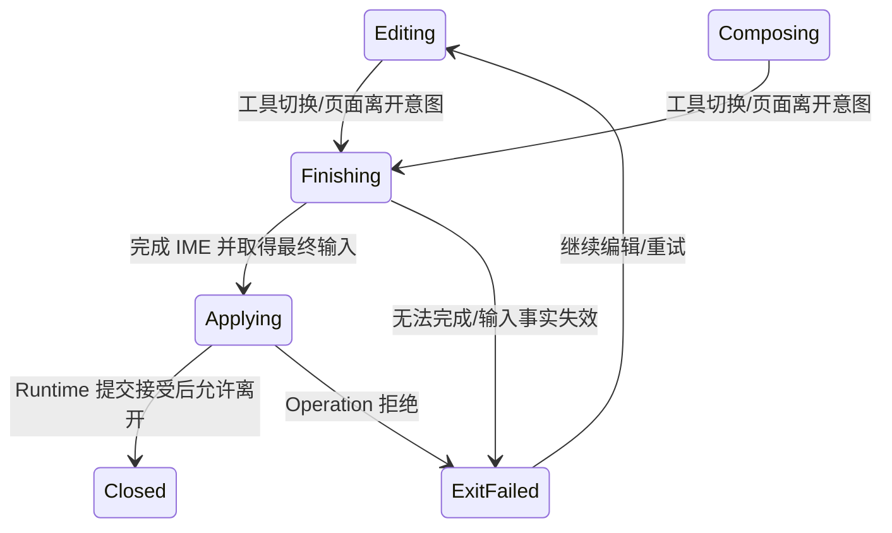

# FC-02 文本编辑：产品行为与持久化设计

2026-10-19，设计工作分支 `codex/fc02-runtime-boundary-design`。
源码审计基准 `80750576443a79b6057b571697787970ffcbb7b9`；其 main 基准为
`ea135122f8e3266cafa433d69903f7950a5e6300`。

本轮负责产品对象、交互与语义变更设计。目标是让独立 RichText 对象能够创建、编辑、
按自身宽度换行、保存回放及撤销重做，并保留共享 Runtime 的单一状态归属。
下述用户决策已确认；宽度载体、版本、migration、精确 Undo 和混合 Snapshot 方案已经在
[后续语义合同](FC02_SEMANTIC_CONTRACT.md)收敛为一个设计。该合同取代本文件的候选表述，
尚未修改生产代码、发布 registry、proto、Authority、Golden 或验收状态。

## 1. 已确认的产品规则

用户修改了最初候选方案，最终记录如下。未提出修改的创建、进入及空草稿规则保留。

| 项目 | 本轮行为 |
| --- | --- |
| 创建/进入 | 文本工具单击创建草稿；双击现有文字进入编辑 |
| Enter | 结束编辑；输入法仍在确认候选时，该次键事件先交给 IME，不能同时触发编辑器结束 |
| Ctrl+Enter | 编辑器处理该命令时插入段落 |
| Esc | 取消未提交合成，已提交文字保留；无合成时退出文本编辑，先于未来 Group scope 退出 |
| 切工具/离开页面 | 自动完成并提交当前合成，然后完成受控切换/离开 |
| 新建空草稿 | 未形成非空提交时不进入 Document，不生成空对象或 Undo 项 |
| 文本框宽度 | 每个框独立，进入持久化语义；不能只存在 UI、view 或 LayoutContext 中 |

IME 候选确认与 Enter 命令必须通过 adapter 的合成事实区分，不能仅依赖 keyCode。
后续合同将本轮单击创建默认宽度选为 320 本地单位；拖拽创建不在本轮新增。
新建草稿的宽度在第一次有效提交时与文本一同持久化。

既有对象被用户删成空文本后仍是既有对象；“空草稿不保存”不意味着离开时偷偷删除它。

## 2. 基础与本轮增量

- [ADR-0006](../adr/0006-richtext-first-class.md)：共享文本模型、Interaction 编辑会话、
  平台输入适配及单一派生排版层。
- [FC 当前策略 v0.3](https://app.notion.com/p/3f74c57a590c812a8260dcf23b659ed0)
  与 [G6 v0.3](https://app.notion.com/p/3f64c57a590c81869d6ee408382a9137)：
  FC-02 负责初始编辑器，后续 G6 消费同一实现。
- [既有 FC-02 审计](https://app.notion.com/p/3f74c57a590c81d4b813ceacab2f2506)：
  设计输入，曾明确把创建/退出和文本宽度列为未决；不把旧审计当作接口冻结。
- [RichText V1](../notion/authority/04-semantic-schema/05-leaf-schemas/richtext-wire-schema-v0.1.md)、
  [ObjectContent 边界](../notion/authority/04-semantic-schema/01-object-schema/object-content-v1-field-table-v0.1.md)
  与 [ObjectKind 版本表](../notion/authority/04-semantic-schema/01-object-schema/objectkind-version-registry-v1-release-v0.1.md)：
  现有段落/run/scalar 位置复用，独立宽度是新增持久化语义，不能伪装成已发布 V1 字段。

首个可用宿主切片面向 Windows/Web；Android 编译修复继续按用户要求延期，适配合同需保留
相同语义。Clipboard、ShapeText/Sticky、Lasso/高级多选、字符并发合并、G5 性能与后续
G6 恢复工程不在本轮实现范围。独立宽度需求也不自动批准这些范围。

## 3. 对象与状态归属

| 状态 | Owner | 存储/恢复 |
| --- | --- | --- |
| ObjectId、ParagraphId、paragraph/run/style、独立宽度 | Semantic | Snapshot/Operation/replay |
| 草稿、插入点、文字选区、typing style、合成、退出意图 | Interaction / EditorSession | 本地会话，取消可丢弃 |
| EditorProjection 与 UTF-16/scalar/UTF-8 映射 | Interaction | 带内容版本的可重建投影 |
| 排版、自动高度、caret/selection geometry、字体物化缓存 | TextLayout / Scene / Render | 派生，可重建 |
| native/DOM 输入代理、候选窗口、物理焦点 | Platform host | 平台生命周期事实 |
| 命令顺序、提交回执、页面/工具切换准入 | composition-owned Facade | Runtime owner 序列 |
| 资源字节与 Saved/Synced 状态 | 既有资源/Data 边界 | 不由 editor widget 替代 |

宿主只报告输入与焦点事实、执行受控 IME 完成请求。它不构建 canonical RichTextDelta，
不复制权威 TextDocument，不持有另一套文档 Undo，不通过外部 Operation 注入接口绕过
本地编辑历史。Debug UI 仍通过 RuntimeFacade 发意图并读回结果。

## 4. 宽度的持久化含义

独立宽度是对象本地坐标中的**换行约束宽度**，不是屏幕像素宽度。采用固定宽度、自动高度：

- 改宽度会重排段落并改变派生高度/Bounds，不改变字号或 Object Transform。
- 整体缩放使用 Object Transform；字体与宽度的 canonical 值保持不变。
- pan/zoom/DPI/窗口 resize 只改变映射和呈现，不产生宽度 Operation。
- 换行、glyph、行高结果、caret box、缓存 revision 不写回 Document。
- 宽度须有限且大于零；具体 binary32 正常数边界及统一转换规则见后续合同第二节，
  不能由不同宿主各定一套或静默 clamp。
- 对象宽度进入内容身份、序列化、digest、Snapshot、replay 和 Undo 的一致性检查。

新建文本框保存自己的显式宽度，默认工具宽度也必须写入对象，不能依赖以后可能改变的
宿主默认值。旧 RichText/1 仍保留原有布局上下文语义，不能把源码中当前的 128 常量
静默回填成所有旧对象的 canonical 宽度。

## 5. 存储与 mutation 方案比较

| 方案 | 优点 | 代价/问题 | 本轮建议 |
| --- | --- | --- | --- |
| RichTextContent 的版本化布局约束；扩展 EditRichText delta | 宽度与文本结构由同一语义 owner 管理；可单 Operation 修改 | 需显式版本、migration、旧 reader 拒绝及 inverse 设计 | 已选择，见后续合同 |
| 现有 PropertyBag 增加专用字段，用 PatchProperties | 可以复用 property History 路径，旧 validator 对未知 FieldId 会拒绝 | 仍须发布新的 registry 字段；当前 PropertyValue 没有 double，且 Property impact 不会自动触发文本重排 | 不采用，保留取舍原因 |
| 扩展 SetObjectSize 的 width/height 用法 | 控件名称相近 | 自动高度不是 canonical 输入；不能为了沿用接口伪造 height，或把 resize 与排版宽度混为一谈 | 不采用 |
| 宿主/View 字典保存宽度 | 接线简单 | 新宿主、Snapshot、replay 与 Undo 丢失语义；形成第二状态源 | 不采用 |

宽度归 RichTextContent，因为它改变对象的换行/布局结构。实施需要显式语义增量，
不能通过隐藏字段、任意 JSON 或复用现有 FieldId 绕过发布合同。

### 版本化内容方案

以下 `RichText/2`、`RichTextDelta/2` 是后继合同选定的拟议版本，尚不是已发布数值分配。

1. 旧 RichText/1 内容、编码与布局默认值原样保留。
2. 新文本内容增加显式固定宽度约束；新对象通过同一个 InsertObjects 保存文本和宽度。
3. 普通文本步骤保持 scalar 语义。新增布局步骤通过现有 EditRichText Operation 修改
   整个对象的宽度；它不是逐段设置宽度，也不引入新 OperationKind 或全局 Transaction。
4. 宽度更新携带单次有效最终值；拖动期间只有 transient reflow，松手才提交。
5. 旧对象取得独立宽度需要显式、原 ID 上的格式迁移，不能 Delete/Reinsert 或编辑即升级。
   版本化布局步骤表达目标布局格式：`LegacyV1` 或 `FixedWidthV2(width)`，
   原子改变对应的内容版本。迁移 inverse 必须恢复旧版本与缺省状态；若不能做到，
   不能以“看起来一样”代替恢复。精确字段、guard 与版本转换规则见后续合同。
6. 为先收窄 mutation，布局步骤初版独占一个 delta；它不与 text replacement 或
   Transform 组成假原子操作。新建时文本、宽度和 Transform 已在一个 InsertObjects 内。
7. 普通宽度编辑左上本地锚点固定，先通过数值控件/右侧重排把手实现。
   左侧把手保持右边缘涉及额外平移，不能悄悄分成宽度、Transform 两次提交冒充原子 resize。
8. 新 reader 同时读取原格式与新格式；旧 reader 必须拒绝不支持的对象/delta，而不是
   丢掉宽度后继续保存。Snapshot/能力准入也须覆盖整个文档，不能靠 UI 隐藏控件代替。

### Operation / 兼容矩阵

对照当前 `validator.cpp`：Operation `schema_version=1`、`payload_version=1` 是普通
对象/文本入口；payload 2 有既有 Brush 专用语义。保留该 envelope，让内容版本与
delta 版本各自承担新文本格式准入，不占用 Brush 的 payload 2。

| 意图 | 候选 canonical 结果 | inverse / 边界 |
| --- | --- | --- |
| 新建有宽度文本 | 一个 schema1/payload1 InsertObjects，含 RichText/2 与显式宽度 | DeleteObjects；Redo RestoreObjects 保留对象、段落身份和宽度 |
| 编辑旧 RichText/1 的文字 | 新 editor 使用 EditRichText + guarded delta2，仍保持 V1；历史 delta1 保留 | delta2 Restore 完整前像，保留原 run 边界 |
| 编辑 RichText/2 的文字 | EditRichText + guarded delta2，使用既有文本步骤语义 | delta2 Restore 完整前像，包括段落/style/布局 |
| 新格式宽度 W0→W1 | EditRichText + delta2，唯一布局步骤，目标 FixedWidthV2(W1) | FixedWidthV2(W0) |
| 旧对象明确取得独立宽度 | 同一对象 ID，唯一布局步骤 LegacyV1→FixedWidthV2(W)；原子更新内容格式版本 | 显式 LegacyV1 布局步骤恢复原缺省状态与 kind_version |

`LegacyV1` 是迁移 inverse 的明确目标状态，不是把宽度设零、不完整 V2 或任意 kind
转换。进入 V2 必须有有效宽度；回到 V1 必须移除该扩展；不匹配的格式/字段组合一律拒绝。
布局格式切换只在独占布局步骤或精确状态恢复中允许，不在普通文字步骤或 codec 里隐式发生。对其它 Kind
以及未经定义的版本迁移均拒绝。

含 V2 文本的新 Snapshot 继续消费已有资源清单 Snapshot3 通路，不自动增加第四种
Snapshot 格式；需要在 capability 与对象版本双层证明旧 reader 整体拒绝。已有 Snapshot1/2/3
与旧对象的编码不因本轮设计被重写。能力标识、具体 proto tags、版本化布局载体及 guard
projection 见后续合同；实施前需要严格接入，不能仅放宽新 reader 便宣称兼容完成。

源码还有一个必须纳入的共存问题：`snapshot.cpp` 与 `snapshot_bootstrap.cpp` 目前只在
Snapshot2 + Triangle capability 下允许 Shape/2 Triangle；不能据此声称 Snapshot3 已经
可以保存包含 Triangle 和字体资源的新文本混合文档。后继合同必须支持组合能力准入，
同时保留旧 reader 的拒绝规则；不能给互斥的 enum 多添一个 Text 值就忽略 Triangle 能力。
这属于 FC-02 持久化共存所需的窄集成，不等于重做旧测试接线或 Android 修复。

此文件不修改冻结 registry。实施前应在同一变更中绑定上表对应的严格 codec、mutation、
前像恢复与旧 reader 负例；不能先接受新对象，再补这些约束。

## 6. 创建、编辑与结束的时序

### 新建

点击只建立 `DraftNew`，Runtime 分配会话及待用身份并显示草稿/插入点；此时对象数、
Operation 数不增加。首次非空 confirmed commit 产生一个 InsertObjects，包含有效段落、
样式、宽度和位置。成功后进入既有对象编辑；失败保留可恢复的编辑状态并报告拒绝原因。
空草稿取消或完成不产生 canonical 修改。首笔插入的 Undo 删除该完整对象，Redo 恢复身份和宽度。

### 既有对象编辑

合成更新只改 transient draft。confirmed replacement/delete/段落/样式变化形成一个
EditRichText，其多个内部步骤由 Semantic 原子校验和 apply。宽度变更沿上述独立布局 delta。
重复的 terminal callback 不可提交两次；回执之前不把 widget 的本地内容宣布为已提交。

### 切工具/受控离开自动提交

这是一条显式产品结束意图：Runtime 协调完成 IME、canonical commit、回执与切换，
宿主不能先销毁输入代理再希望迟到 callback 补交。没有合成时只完成已确认输入的顺序屏障；
已经提交过的文字不会重复提交。若失败，受控离开保持未完成并读回原因，不伪报成功。

受控工具切换/页面导航与强制销毁、进程中断是不同情形。正常路径必须在不可逆离开前
发出完成请求。已经发生的强制销毁无法承诺完成 IME/写入；后续 callback 必须失效。
这里的 canonical commit 也不等于 Data Runtime 已落盘或已同步，仍使用既有 Saved/Synced 事实。

用户本轮“退出时自动提交”取代此前草案的普通工具/页面退出取消策略。它不把任意底层
lifecycle 通知直接解释成“将最后一帧合成预览写入文档”；主动结束与异常中断分开记录。

## 7. Undo、冲突和派生状态

- EditorHistory 需要接受 EditRichText 的 forward/inverse。文本 inverse 使用 delta2 的
  完整状态恢复，精确保留前像 run 边界、段落 ID/样式和布局；现有六步骤的简单反向序列
  不能保证精确可逆，已用当前 Semantic 代码复现。不能把字符数当 UTF-16。
- 宽度 Undo 恢复前值；格式迁移 Undo 还须恢复内容版本/缺省状态。使用新的 Operation ID
  重放 inverse，文档对象/段落身份保持原语义。提交被拒绝时不新增成功的 History 项。
- 初版一次 confirmed edit 或一次最终宽度修改对应一个 Undo 项；长时间连续输入合并
  与多 Operation 用户历史组不在此处自动扩展。内部多-step delta 仍是单 Operation。
- 远端有序 canonical apply 不等待文本会话。无关对象变化可继续；目标内容变化使旧投影
  stale，需明确 resync/取消旧合成。不能仅凭全局 generation 不同就取消所有编辑，也不能
  静默合并同对象并发文本。Undo 必须检查对应内容/布局前置条件，不能覆盖远端新内容。
- 单一 TextLayoutService 消费每对象宽度及字体资源生成派生上下文；不同框不能通过改
  一个全局 LayoutContext 相互影响。宽度须进入相关 cache key、重排影响和派生发布身份。
- 字体继续通过 ResourceManifest/ResourceProvider 提供。现有测试 CJK 字体只是小 subset，
  不能据此承诺任意中文/emoji 显示；编辑可提交与实际 glyph 可显示分开验证。

## 8. 当前源码差距与下一切片

| 现状 | 必须补的实际能力 |
| --- | --- |
| RichTextContent 只有 document，delta 是六种 V1 步骤 | 独立宽度的版本化内容、mutation、迁移/兼容与 inverse |
| EditorHistory 的白名单不含 EditRichText | 在写入前保证命令/历史可记录，不能先写入再因不支持而 terminate |
| OperationRequest 有 64 位遗留身份检查 | 文本路径使用完整身份与 owner 分配，不能截断对象/Operation ID |
| RuntimeComposition 创建一个宽度 128 的 TextLayoutService | 按对象 canonical 约束解析派生上下文，保留 legacy 语义 |
| Triangle Snapshot2 准入与资源 Snapshot3 通路尚未统一 | 同文档 Triangle + 新文本/字体资源的组合能力、codec 和 bootstrap 合同 |
| Snapshot 有 glyph cluster/line，尚无完整编辑查询 API | 同一布局 owner 内补 caret/selection/hit geometry；不按平均字符宽度猜 |
| Minimal Host 只有 pointer/control 和 Debug UI 字符输入 | 产品文本 ingress/projection、真实 IME、单一焦点/输入路由与退出屏障 |

宽度格式/版本、迁移、Undo 与 Snapshot 的可审查模型已在后续合同完成，下一步推进接口。
首个可编码切片应先满足严格语义准入/History，再接
共享 Runtime 的投影/会话与 FakeIME，随后才接真实 Windows/Web。此处不先做一个 DOM
权威编辑器或临时宿主文本框来绕过模型。

实现前至少用以下失败场景约束设计；这些是待执行的目标，不是本轮 PASS 记录：

| 输入/失败 | 必须观察到的结果 |
| --- | --- |
| 两对象同文不同宽度，保存/重开/replay | 宽度分别保留；布局互不污染；canonical 结果一致 |
| 宽度拖动、取消、确认、Undo/Redo | preview 不写文档；确认单次提交；前值/身份正确恢复 |
| `A😀B`、组合字符、跨段 replacement | scalar 映射正确；任一步失败整 Operation 不写入 |
| 新草稿合成多次、取消/空结束、首次确认 | 对象/Operation 数分别为零、零、一个 InsertObjects |
| Enter 候选确认，随后 Enter 结束；Ctrl+Enter | 不误退出、不重复提交；换段保持 ParagraphId 规则 |
| 合成中切工具/离页，IME 完成或拒绝 | 成功先提交再切换；失败可见；迟到 callback 不写新目标 |
| target 删除、远端修改、旧版本投影 callback | 不 veto remote；旧输入不能落到新内容/新会话 |
| 老 reader 读新宽度格式，升级/撤销 | fail closed；无宽度丢失；legacy 前像可恢复 |
| Triangle、Ink、Shape、新文本与字体资源同文档保存/恢复 | 新能力集完整准入；旧格式原样保留；不能只单测纯文本 Snapshot |
| zoom/DPI/resize 与字体资源变化 | 坐标只映射一次；canonical 宽度不变；正确重排/失效 |

下一步交接物是受后续合同约束的 Runtime 接口设计；尚未启动生产实现。Snapshot3 现有
digest 投影与绑定合同的差异已明确记录，持久化写入前必须在原边界解决，不能静默改算法。
