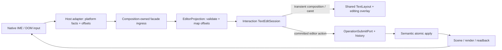

# FC-02 RichText editor: Runtime boundaries (design draft)

Status: conditional architecture draft, updated 2026-10-19. No implementation or new stable ABI.
Baseline main: `ea135122f8e3266cafa433d69903f7950a5e6300`, merged via
[PR #148](https://github.com/Mostorm-Labs/axiom/pull/148), containing integration
head `6d8bf236468c3dd2a29d7ba213125df8ba12b840`.
Design branch: `codex/fc02-runtime-boundary-design`.

The user has confirmed per-object persistent text-box width, Enter to finish,
Ctrl+Enter for a paragraph, and automatic composition completion/commit on tool
switch or controlled page exit. See [the product and semantic design](FC02_PRODUCT_AND_SEMANTIC_DESIGN.md).
The [semantic contract](FC02_SEMANTIC_CONTRACT.md) now selects versioned layout,
explicit migration, guarded exact-state undo and combined Snapshot3 admission.
Detailed APIs must consume that contract and its identified persistence blockers.
The [Runtime input contract](FC02_RUNTIME_INPUT_CONTRACT.md) now gives concrete
session/projection/geometry identities, proposed facade members, owner ordering,
exit barriers and a compilable FakeIME protocol model. It is not production wiring.
This updates the earlier uniform-width and cancel-on-exit
candidate assumptions below; it does not change published semantic authority.

The user authorized the merge after schema-check alignment and explicitly
deferred legacy Web/Playground test wiring and Android compilation repairs.
Those known integration failures remain unresolved on this baseline. They are
not an FC-02 implementation result or evidence of full CI/physical acceptance.

## Purpose and scope

Add bounded RichText creation, editing, caret/selection, IME composition and
committed undo/redo to the shared Runtime consumed by Minimal Host. The user's
requested sequence is FC-02 → FC-03 → FC-01A → FC-04. This document records that
direction without rewriting historical execution/Gate records.

FC-02 reuses the existing RichText document and G4.7 layout stack, and proposes a
versioned semantic addition for independently persistent text-box width.
It includes the text producer's object bounds and common selection capability;
FC-01A/FC-04 can then operate on the produced objects. It does not implement
lasso, advanced multi-object editing, Sticky/ShapeText, clipboard, character-level
collaborative merge, G5 performance work or the later G6 recovery programme.

## Sources and present implementation

- [ADR-0006](../adr/0006-richtext-first-class.md): Runtime text model,
  interaction-owned editing, thin platform adapters, derived layout.
- [Current G6 v0.3](https://app.notion.com/p/3f64c57a590c81869d6ee408382a9137):
  bounded initial editing moves to FC-02; later G6 consumes the same owners.
- [Current FC policy v0.3](https://app.notion.com/p/3f74c57a590c812a8260dcf23b659ed0):
  object producers supply their selectable geometry; selection stays local.
- `runtime/semantic/include/canvas/semantic/object_content.hpp` already has
  paragraphs, runs, styles and scalar-indexed `RichTextDelta` steps;
  `operation_payload.hpp` has `EditRichTextOp`.
- `runtime/text/include/canvas/text/text_layout.hpp` already provides one
  `RichTextLayoutService` and immutable `TextLayoutSnapshot`.
- `RuntimeComposition` owns one `RuntimeFacade`. `EditorSession`,
  `InteractionSessionManager` and `OperationSubmitPort` exist. Production
  `TextEditSession`, `EditorProjection` and the text input facade are still gaps;
  qualification-only text mutation helpers are not an editor API.

## State ownership

| Owner | Owns | Boundary |
| --- | --- | --- |
| Semantic | Canonical RichText document, validation, atomic operations/replay | No native widget, caret, IME composition or layout snapshot in canonical state |
| Interaction / EditorSession | TextEditSession, caret/range, composition draft, editor action resolution and undo intent | Only existing operation submission/history path may commit |
| Interaction projection | Bounded editable projection and offset maps tied to a target and revision | Reconstructible; never a second canonical TextDocument |
| Text layout | Shared shaping, line/cluster geometry, fonts and layout caches | No editing session or focus authority; no DOM/native parallel layout engine |
| Composition / Facade | Single owner queue, target validation, action receipts and readback | Host and Debug UI borrow the existing facade; no alternate mutation owner |
| Platform host | Native text service/DOM input adapter, physical focus, candidate window, native lifecycle facts | No canonical Paragraph/TextRun construction, RichTextDelta generation or direct editor access |
| Render / Scene | Derived text/selection/caret presentation and text object geometry | Existing frame opportunity/completion and resource-generation contracts |
| External data owner | Persistence and committed operation transport | Host IME input does not use `applyExternalOperation` to bypass local editing/history |

`TextEditSession` belongs under `runtime/interaction`, orchestrated with existing
sessions. It does not become a standalone editor in `runtime/text` or an app-side
controller. Reconcile the current minimal `EditorSession` integration seam before
adding a second session owner. No parallel Registry or new canonical ObjectKind
is proposed. The semantic design selects RichText/2 layout and guarded delta2
text/layout/restore operations; proposed wire identifiers are not yet published.

Runtime allocates object, paragraph and operation identities. Keep full canonical
IDs across the facade/projection boundary. The present generic `OperationRequest`
also carries a legacy 64-bit identity and its `CanvasEditingRuntime::submit` path
needs explicit history/admission reconciliation before reuse for text editing;
neither truncating IDs nor calling that helper from a host is an acceptable
shortcut. Existing write admission, read-only/lock rules and atomic rejection must
apply equally to text and Debug UI control intents.

## Input, projection and commit flow

1. A text tool/entry intent enters the existing Facade lane. Runtime resolves the
   target, attachment and editing session; the host receives a bounded projection
   and physical focus request. Text-tool click creates a draft; double-click edits
   existing text. The first nonempty commit inserts one complete object.
2. The adapter reports composition begin/update/end/cancel, replacement text,
   selection and focus facts with the projection token. Runtime converts offsets
   to `ParagraphId + Unicode scalar index`, validates the session and resolves
   normalized actions. The adapter never supplies a canonical operation.
3. Composition updates only change transient state and derived presentation.
   Cancel-before-commit emits zero canonical operations and leaves the canonical
   digest unchanged. Cancel does not undo earlier committed edits.
4. A committed edit becomes a validated `EditRichTextOp` (or the existing object
   insertion operation for creation) through the Runtime-owned submission/history
   path. A rejected operation does not publish success or advance the projection
   as though applied. Repeated terminal callbacks must not commit twice.
5. Accepted semantic change rebuilds/reconciles the projection and derived layout;
   receipts and snapshots let both the product UI and Debug UI observe the result.
   Presentation uses existing Runtime frame identities and feedback, including
   retry; hosts do not retire text overlays on their own.

The text ingress and projection readback are proposed typed additions to the
existing public facade/composition boundary. Their exact C++ shape and transport
encoding require a separate interface design; no header or stable ABI is frozen
by this draft. High-frequency editor input must retain ordering and terminal
events without routing each IME update through an inspector-style control draft.

## Identity, positions, layout and focus

- Validate runtime/attachment identity, full object ID, text session generation,
  projection/content revision and ordered event identity. Geometry freshness also
  includes layout/font and view/metrics generations. These are distinct axes;
  resizing a surface does not itself replace a text document.
- Old callbacks after cancellation, detach, target replacement or projection
  rebuild cannot mutate the new session. A stale mutation is rejected and the
  adapter is resynchronised. Behaviour during a conflicting remote edit must
  consume the existing interaction-conflict authority, not invent text CRDT rules.
- Native UTF-16 offsets, canonical scalar positions, UTF-8 layout cluster offsets
  and user-perceived grapheme boundaries are different units. Map explicitly and
  version the mapping with the projection. `A😀B`, combining marks, ZWJ emoji and
  paragraph boundaries must be covered before a platform adapter is considered
  usable. Invalid offsets must not silently split a surrogate or UTF-8 sequence.
- Consume G4.7 geometry for caret, selection and hit testing. If the current
  snapshot lacks a query, extend that service's derived geometry seam. Do not
  introduce a DOM measurement engine. `LayoutContext.width/revision` is container
  policy. For new fixed-width text it is resolved from per-object canonical
  width; retain the legacy context behaviour for old objects. Layout snapshots,
  height, cache revision and camera zoom remain derived rather than width truth.
- Host maps screen/client coordinates to logical view once; Runtime applies
  view/world/object transforms. The reverse caret anchor is returned with
  geometry/metrics identity so the host positions the native candidate UI once.
- Separate object selection from text-range selection. Pointer, keyboard and IME
  routing has one accepted interaction owner at a time; text input and Debug UI
  must not also draw on the canvas. Existing multi-contact intent policy remains
  unchanged; entering text editing must use its interruption/focus rules.
- Tool change and controlled page exit now request composition completion and
  canonical commit before allowing the exit, per the user's product decision.
  Enter finishes and Ctrl+Enter inserts a paragraph outside IME key consumption.
  Escape cancellation, forced host detach and late callbacks retain explicit
  termination/failure fences; native blur alone is not a successful commit receipt.
- Native editing controls may carry a bounded disposable text projection, but
  their local undo stack cannot become document history. Runtime remains the
  committed Undo/Redo owner; composition-local undo needs explicit routing.

## Inputs to the next interface design

| Area | Settled input / remaining interface detail |
| --- | --- |
| Creation | Click/double-click and empty-draft rules retained; width preset 320 is stored on first insertion; no added drag-create |
| Entry/exit | Enter finish / Ctrl+Enter paragraph / auto-finish on tool or controlled page exit confirmed; failure/callback order needs design |
| Sizing | Semantic contract selects content layout, explicit guarded migration, fixed local anchor and derived height |
| History | One confirmed edit/final width is one item, guarded full text preimage restoration; no initial typing grouping; route composition-local Undo |
| Formatting | Initial enabled inline/paragraph controls and object-selection vs range-selection targets |
| Conflicts | Exact resync/cancel rule for remote changes to active text; no implied concurrent text merge |
| Platforms | First usable Windows/Web slices and Android adapter timing; no inferred physical acceptance |

The semantic contract settles persistence and Undo; the next pass resolves the
remaining interface details. This does not permit inferring additional semantic
fields or copying POC-04 `TextTransaction`/UTF-16 canonical positions.

## Proposed implementation slices and minimum proof

1. Consume the semantic contract's creation/exit, versioned width, exact Undo and
   mixed-document rules. Design interfaces for history preflight, conflict notices
   and layout geometry. Resolve the recorded Snapshot3 capability/digest gaps
   before enabling the new persistence writer; preserve frozen legacy evidence.
2. Implement a Runtime-owned session/projection with FakeIME first. Prove repeated
   updates preserve canonical state, one accepted commit applies once, cancellation
   produces no operation, rejection resyncs, and stale tokens cannot edit new text.
3. Add shared geometry/caret overlay and text producer selection readback. Verify
   Unicode mapping, fixed-font layout parity, pan/zoom and DPI/resize coordinates.
4. Connect thin Windows and Web adapters to the same ingress/readback. Test IME
   terminal-event differences, focus/tool changes, Debug UI isolation, history and
   render retry. Track automated and human observations separately.

The detailed interface pass is now captured in the Runtime input contract. Its
FakeIME model exercises protocol ordering; actual Facade/Semantic/History and
platform integration remain implementation work, not an acceptance claim.
