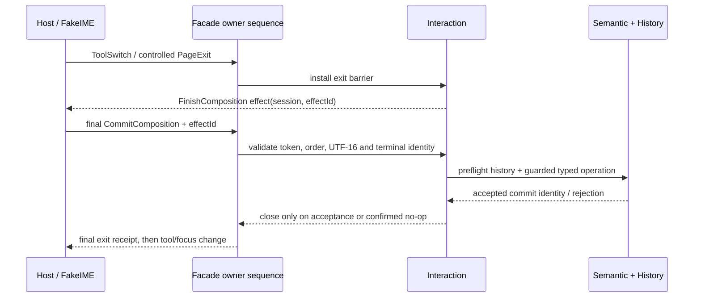

# FC-02 Runtime 文本接口、时序与 FakeIME

2026-10-19；源码/语义设计输入 `79aa19c15dc60df633ad5a9eab7aaeb7a46866ed`。
分支 `codex/fc02-runtime-boundary-design`，main 仍为
`ea135122f8e3266cafa433d69903f7950a5e6300`。

这是基于[语义合同](FC02_SEMANTIC_CONTRACT.md)的 P14–P17 接口设计和可执行协议原型。
原型放在 `docs/planning/fc02/prototype/`，没有导出/安装公共头，没有修改生产 Facade、
Semantic、宿主或稳定 ABI。新内容版本仍是设计输入，不冒充已发布 Authority。
持久化所依赖的现有 Snapshot3 差异仍按原合同 fail closed；本稿不重定义其算法。

## 1. 接入现有 owner

| 现有位置 | 本轮明确的接入职责 | 不能绕过的边界 |
| --- | --- | --- |
| foundation `RuntimeFacade` | 增加 typed 文本 intent、input、snapshot/receipt 查询 | 不通过 applyExternalOperation 提交本地文字 |
| composition `CanvasRuntimeFacade` | 统一命令顺序、target 准入、receipt/effect journal | 不持有第二个 TextDocument/Undo |
| `RuntimeComposition::ownerPump` | 既有 owner safe point 执行输入、退出屏障和派生更新 | 不在 IME 回调中重入 apply/布局 |
| `InteractionRuntime` / `EditorSession` / SessionManager | 在既有单会话 owner 下持有一个 TextEditSession、投影和编辑动作解析 | 不从宿主另建 Editor controller 或第二个 manager |
| `CanvasEditingRuntime` + EditorHistory | 完整 ID 分配、写准入、Semantic prepare/apply、History 预留及发布 | 不使用 64 位 OperationRequest.operationId 作 canonical 身份 |
| `RichTextLayoutService` | 对象宽度、字体身份、caret/selection/hit geometry | 不用 DOM/native 测量或平均字宽作为第二布局引擎 |
| Minimal Host Windows/Web | native/DOM facts、UTF-16 payload、物理焦点和 IME 完成请求 | 不生成 Paragraph、RichTextDelta 或直接改编辑状态/D3D12 |

当前 `InteractionRuntime::commit` 会在核实完整目标/会话之前调用提交口；其普通重载只检查
activeCount，keyed 重载也是提交后才 finish。文本入口必须**先**验证 issued session、投影、
目标，再进入内部 typed command 路径，不能直接套用该 helper。既有 History 的 apply 后
record-or-terminate 路径也要按语义合同改为 apply 前准备；本轮没有声称这些缺口已修复。

## 2. 身份分轴：resize 不等于换文档

当前 `refreshControlTarget()` 把 resource lifetime 放入 runtimeEpoch、surface metrics 放入
viewEpoch，`surfaceBindingChanged()` 又推进 attachmentEpoch。故 CanvasTargetKey 适合
一次控制/几何准入，不能直接作为长寿命文本输入身份。

拟议[可编译类型](fc02/prototype/text_input_contract.hpp)分成三层：

| 身份 | 字段/owner | 何时失效 |
| --- | --- | --- |
| SessionKey | 现有 runtimeInstanceId；完整 DocumentId；文档 attachment serial；ViewId；adapter binding serial；session serial，均由 Runtime 签发 | 换文档/真正 detach、换输入代理、关闭/重建会话 |
| ProjectionToken | SessionKey + 完整 ObjectId + projection revision；新草稿也用 Runtime 保留的完整 ID | 接受的文字变化、相关远端内容/宽度变化、投影窗口重建 |
| GeometryToken | 当前 CanvasTargetKey + projection/layout/font/viewport revision | resize、DPI、pan/zoom、字体/布局/表面变化 |

文档 attachment serial 是同一 owner 的本地计数，不是新的 canonical 对象、Registry、
Document 字段或稳定 ABI。它不能复用随表面变化的 resource lifetime。surface resize 只
更新 GeometryToken；输入代理仍有效时保留 SessionKey 和正在进行的合成。若平台实际取消
IME，则报告真实 Cancel/SourceLost，不能仅因为坐标变化猜测一次提交。

所有 serial 非零、单调分配、溢出拒绝，不回绕复用。ObjectId/ParagraphId/OperationId
保留 raw128。Web bridge 中 raw128 用固定 32 位小写 hex，uint64 用十进制字符串或受控
BigInt 通道；不能经 JS Number 截断。宿主只能回传签发的 token，不能自造新会话身份。

## 3. 拟议的 Facade 方法与数据

以下是现有 RuntimeFacade 的成员增量设计，不另建 host 可构造的运行时服务。
实际导出前消费语义版本准入；原型 TextIngress 仅代表其中的 submit/read seam。
基础 Facade 的未支持实现明确返回 Unsupported，不因增加纯虚方法迫使无关旧 adapter
伪造支持；MinimalRuntimeFacade 仅转发给现有 composition-owned facade。

| 方法 | 输入 | 回执/读回 |
| --- | --- | --- |
| submitTextIntent | clientId/requestId、当前 CanvasTargetKey、typed intent：进入新草稿/编辑既有 full ObjectId；对已 issued token 的 Finish/InsertParagraph/Escape/Retry/Resync/SetWrapWidth | queued/rejected，最终 applied/rejected/closed；接受进入时返回 SessionKey/投影和物理焦点请求 |
| submitTextInput | InputEvent：issued ProjectionToken、每 session/adapter 单调 sequence、InputKind、UTF-16 range/text、composition id、可选 finish effect id | InputReceipt：observed/pending/applied/rejected/stale/collision 等；不把 pending 当作写入成功 |
| readTextEditor | issued SessionKey | 不可变 EditorSnapshot：phase、投影、选区/合成范围、当前宽度、未完成 effect、写准入/资源可用性、相关 receipt 身份 |
| textInputReceipt / textIntentReceipt | 完整 client/request 或 session/sequence key | 原始 outcome 与最终 canonical commit identity；可按 key 读回，不能靠下一帧 UI 猜提交成功 |
| acknowledgeTextReadback | 连续已处理的 receipt/effect frontier | 释放已结束记录；不能淘汰仍 pending/失败待恢复的提交或未完成 finish effect |

进入新文本不接收宿主 TextStyle/Paragraph 列表；Runtime 工具预设负责样式与默认宽度，
点击只带 logical view 点。编辑现有文本带完整 ObjectId，由 Runtime 解析/准入。SetWrapWidth
首版作用于当前 issued 文本会话，固定本地左上锚点，不私自捆绑 Transform。工具/Debug UI
均走同一 Facade 的意图路径；canonical delta 只在 Interaction 内部形成。
SetWrapWidth/格式命令在合成或提交尚未结束时返回 Busy，不擅自扩大“切工具/离页自动完成”
规则。Undo/Redo 在平台合成期间先由 IME 处理，不能同时撤销文档；其它 UI 触发的文档
Undo 此时返回 Busy，合成结束后才走既有 EditorHistory。

输入 kind：BeginComposition、UpdateComposition、CommitComposition、CancelComposition、
ReplaceConfirmedRange、SetSelection。Begin 固定 confirmed 投影中的替换范围；Update 的
预编辑文字/选区只进入 transient projection；预编辑选区的 offset 在 Update.text 内，
不是 confirmed 文档中的替换范围。Commit 带最终内容、相同 composition identity
和原范围；Cancel 不把最后一次 Update 写入。直接 replacement 与 composition lifecycle
分开，零 composition id 不代表伪造合成。终止之后不能复用同一个 composition id。

## 4. UTF-16 投影与几何

Host 范围是 UTF-16 code units；Runtime 投影持有每段 ParagraphId 与 scalar/UTF-16/UTF-8
映射。投影以 LF 表示段落分隔，保留区分 canonical 段落断点的映射项；导入 CRLF 只在
adapter 的平台文本规范化边界转换，不能把两个 code units 错算成两个 canonical scalar。
替换跨段范围由 Interaction 解析成同一个 delta 的有序步骤，先 staged 校验再原子 apply。

offset/count 用检查过的加法；拒绝越界、落在 surrogate 中间、孤立 surrogate 和失效版本。
`A😀B` 的 UTF-16 offset3 对应 scalar2，offset2 不能作为端点。grapheme、scalar 与 glyph
cluster 不互相替代：组合字符/ZWJ 的键盘移动、退格边界使用共享文本栈的 grapheme 事实；
平台报告的合法 scalar replacement 按其确切范围处理，不随意扩成另一个替换。

Projection 是可丢弃窗口，跨段/全文选择由 Runtime 解析；超出当前窗口先 Resync，不能
截断输入继续提交。窗口大小由可读能力事实说明；正在合成时 pin 住替换区，不能无通知
重建映射。超限必须给明确拒绝/重同步回执，不给宿主第二份 canonical 文档来规避。

TextLayout 增量保持在现有 service：按对象解析 LayoutContext；增加带 layout identity 的
hitTest、caretRect、rangeRects 查询，位置为 ParagraphId+scalar/affinity，结果在对象本地
坐标中。Scene/Viewport 转换成 logical view，host 再映射到屏幕候选窗口一次。查询附完整
GeometryToken，过期 geometry 不能用于候选定位；过期 geometry 本身不否决新文本输入。
glyph 缺失/字体未物化返回明确不可用，不借用宿主字体画一份“看起来正确”的几何。

## 5. 单一顺序与退出屏障

当前 CanvasControlService 只排控制。后继实现应在 CanvasRuntimeFacade 的既有 owner 入口
为 control、text、host effect response 分配统一 arrival ticket，再分发到各现有执行口。
不是每 pump 先清控制队列再清文本队列；ownerPumpCount 也不是事件 sequence。IME 事件
保留专用 typed payload，不转成 Inspector draft/CanvasControlRequest 的任意字符串字段。

屏障只挂起当前目标的后续冲突控制；owner 仍处理其完成输入、回执及其它目标，不能
阻塞线程等待 OS callback。effect 可重复读取，宿主按 effectId 最多执行一次并回送同 ID；
Runtime 不得在轮询中反复命令 IME 完成。native 回调只入队，不重入 owner apply。

Enter 已被 IME 消费用于候选时不同时结束；无合成时 Enter 发 Finish，Ctrl+Enter 发
InsertParagraph，由 Runtime 分配 ParagraphId 并产生一个编辑动作。Esc 有合成时取消
当前合成，无合成时结束编辑；它不撤销之前接受的文字。新空草稿/no-op 不生成 Operation
或 History；既有对象删空保留身份。自动完成失败、被平台取消或 canonical 拒绝均令受控
工具/离页/Debug focus 切换失败且可重试，不能把失败转成成功取消后退出。

Debug UI 获取文本键盘焦点也经过屏障。屏障未完成，画布仍属于文本 owner；完成后焦点
只归 Debug UI。指针路由按已接受 owner 处理，同一事件不能再交 Ink/Shape/导航；点击外部
画布若要求退出，也先解决屏障，不将那次点击重放成落笔。AutoIntent 多指策略保持原样。

强制 detach/崩溃不保证完成输入法。真正的 detach 推进文档 attachment 并使旧 callback
无效：排队未 apply 的动作可取消；已经接受的 canonical 修改不可回滚。回执送达较晚时
按原 request/OperationId 查询，不能因 UI 已销毁就重复提交。surface 不可用只暂停几何/
呈现，不把最后一帧合成擅自提交；当前实现要求 Ready 的 ownerPump 接入时须区分输入
终止/回执处理和 surface work，不将异步 finish callback 永久困在呈现准入后。

## 6. 去重、背压与失败

- journal key 为 issued session/adapter + input sequence（控制为 client/requestId）。同 key
  同 payload 重放原回执；不同 payload 返回 collision。去重先于 projection stale 判断，
  所以成功后重试旧 token 仍能取得原提交结果，不二次编辑。
- 带新 sequence 的重复 terminal 用 composition id 和原 payload 再检查，不能让浏览器
  compositionend + beforeinput 同时提交。adapter 将同一次 native confirmed mutation 关联
  为一个 terminal identity；无法证明相同就拒绝/Resync，不能只按字符串相等全局去重。
- 只接受下一个序号；缺口不前进。pending/busy/backpressure 没接收的新事件由 adapter
  保留并重试，不能把 rejected 序号当新序号再偷偷重投。终态值错误的已接收事件有失败回执，
  后续从读回 frontier 继续；旧会话错误不消耗当前会话序号。
- 有界 journal、输入缓冲和 effect 记录不能静默丢 terminal。可在未入 owner 顺序之前合并
  同一次合成的未确认 Update，不能跨 Begin/Commit/Cancel/intent 边界；原型暂不合并。
  adapter 无法继续保留时中止该合成并 Resync，受控退出失败，不能用 preview 伪造 Commit。
- 未完成提交不淘汰。ack 后的过期重试返回 expired，不重新 apply；显式已知拒绝的恢复与
  “结果未知”的重试分开。显式恢复用新 intent key，原请求的终态拒绝回执不改写；结果
  未知沿用原 OperationId 查重，不能盲目分配新 ID。
- 无关对象/全局 generation 变化不取消文本。相关内容/宽度变化使 projection stale；
  删除目标或换 attachment 结束会话。仅 Transform/viewport/字体可用性变化更新派生几何，
  不把旧文本范围自动移到另一个对象。具体冲突判定消费 Semantic change aspect/内容身份。

## 7. 何时可接入真实 Runtime

协议原型验证已记录于[执行结果](fc02/INPUT_CONTRACT_EVIDENCE.md)。FakeCommitPort 的
accepted/history 计数只用于时序观察；它不是 OperationEngine、Document 或 EditorHistory。
目前没有“文本已进入 Minimal Host”的结论。

实现时按以下依赖顺序接入现有模块，不再重复产品规则问答：

1. 版本化内容/delta2 的严格 codec、state plan、精确 Restore 与 History apply 前准备；
   先用真实 RED 约束三项 Snapshot3 差异并在原边界处理，不改 Authority/旧算法含义绕过。
2. 将本稿 token、事件和统一顺序落到既有 Facade/Interaction；FakeIME 换成实际 Facade +
   真实 Semantic/History 查询，复用本轮事件输入，验证对象/Operation 数及 commit identity。
3. 同一个 TextLayoutService 补每对象宽度及编辑几何，再接 Scene/Render 反馈。canonical
   接受不等于帧已呈现；overlay 生命周期消费既有 Runtime frame/presentation 回执。
4. Windows/Web adapter 对相同协议执行平台真实完成/取消与物理焦点适配；真实操作仍由
   用户验证。旧 Web/Playground 测试接线、Android 编译修复及 G5 工程继续延期。

除上述已指明的语义/持久化接入条件外，本稿没有再添加独立评审或验收流程。
